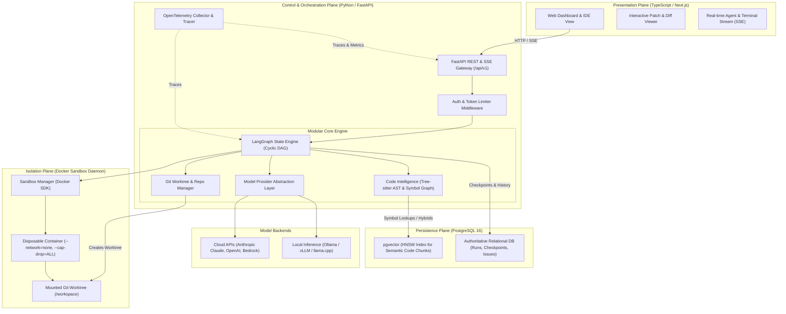
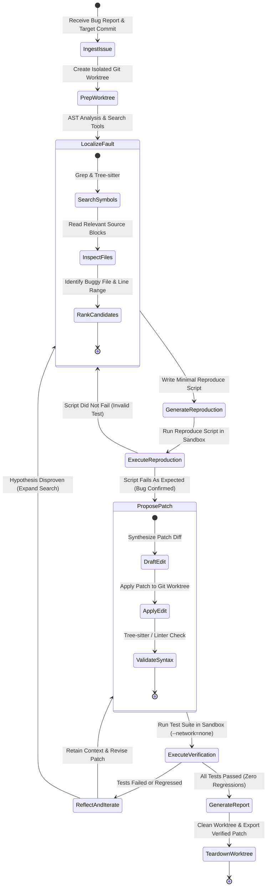

# PROMETHEUS — Systems Architecture Specification

**Document Version:** 1.0.0  
**Status:** Approved Architecture Draft  
**Author:** Lead AI Systems Architect & Research Engineer  

---

## 1. System Vision & Architecture Philosophy

PROMETHEUS is designed as a **modular monolith** with clean, decoupled subsystems. We deliberately reject premature microservice distributed architectures in favor of clear domain boundaries within a unified runtime. This maximizes developer velocity, simplifies local reproduction, eliminates distributed transaction overhead, and retains straightforward single-node or containerized deployments.

### Core Architectural Principles:
1. **Separation of Concerns:** Clear interface boundaries separate the Presentation Plane (Next.js), the Orchestration Plane (FastAPI + LangGraph), Authoritative Persistence (PostgreSQL), and Untrusted Execution (Docker Sandbox).
2. **Authoritative State in PostgreSQL:** Transient memory or in-process variables never dictate workflow integrity. All state transitions, checkpoint snapshots, and audit events persist atomically in PostgreSQL.
3. **Defense-in-Depth Isolation:** Untrusted code from target repositories never executes on the host OS. All test invocations, package installations, and patch verifications run inside disposable, capability-stripped Docker containers.
4. **Resilience & Graceful Degradation:** The platform functions fully without GPUs, without vector databases, and with offline or local model backends (Ollama/vLLM).
5. **Observability as a First-Class Citizen:** Every agent step, tool call, token tally, and sandbox result emits correlated OpenTelemetry spans.

---

## 2. High-Level System Architecture



---

## 3. Subsystem Breakdown & Responsibilities

### 3.1 Presentation Plane (Next.js & TypeScript)
- **Role:** Interactive control surface for engineers, benchmark evaluators, and system auditors.
- **Key Responsibilities:**
  - Launching debugging tasks and benchmark suites.
  - Streaming real-time agent thought logs, tool invocations, and terminal outputs via SSE.
  - Interactive multi-file diff view showing candidate patches against git worktrees.
  - Human-in-the-loop review interface (approving sandbox command runs, overriding agent plans, or triggering patch commits).
- **Communication:** Speaks exclusively to the FastAPI API Gateway via standard HTTP/JSON and EventSource SSE.

### 3.2 Orchestration Plane (FastAPI & LangGraph Runtime)
- **Role:** Central application brain and state coordinator.
- **Key Responsibilities:**
  - Enforcing workflow transitions via LangGraph cyclic state machines.
  - Dispatching tool executions to the Sandbox Manager or Code Intelligence Engine.
  - Managing task concurrency, rate limits, and checkpoint resumption.
  - Recording OpenTelemetry spans for every step.

### 3.3 Code Intelligence Engine
- **Role:** Syntactic and semantic repository comprehension.
- **Key Responsibilities:**
  - **AST Parsing:** Uses Tree-sitter to parse source files into concrete syntax trees, extracting class definitions, functions, imports, and call graphs.
  - **Exact Symbol Index:** Fast in-memory / relational indexing of symbols (`find_references`, `find_definitions`).
  - **Lexical Search:** Ripgrep-accelerated regex and keyword search over the active worktree.
  - **Dense Vector Search (Optional):** Generates and queries pgvector embeddings for issue descriptions and docstrings. If embeddings are disabled or unavailable, system gracefully uses lexical + AST search.

### 3.4 Model Provider Abstraction Layer
- **Role:** Unified, multi-provider model routing and structured generation.
- **Key Responsibilities:**
  - Translating agent prompt templates and tool definitions into vendor-specific schemas (Anthropic Messages API, OpenAI Chat Completion API, Ollama/vLLM endpoints).
  - Strict output parsing and schema validation via Pydantic v2.
  - Intelligent fallback: If Cloud API encounters rate limits (HTTP 429) or token exhaustion, automatically route to configured secondary models or local fallback backends.
  - Tracking token costs and latency metrics per call.

### 3.5 Storage & Persistence Plane (PostgreSQL + pgvector)
- **Role:** Authoritative, ACID-compliant source of truth.
- **Tables & Schemas:**
  - `projects`: Registered repositories, git remotes, and baseline commit configurations.
  - `issues`: Bug tickets, reproduction instructions, stack traces, and test targets.
  - `runs`: Debugging execution instances, status, configuration flags, and outcome metrics.
  - `checkpoints`: LangGraph state snapshots containing agent scratchpads, candidate diffs, and visited files.
  - `code_chunks`: Optional chunked source code with vector embeddings (`vector(1536)` or `vector(384)`) and full-text `tsvector`.
  - `audit_logs`: Immutable security events, executed commands, and container hashes.

### 3.6 Execution Sandbox Plane (Docker Engine API)
- **Role:** Untrusted code execution and patch verification.
- **Key Responsibilities:**
  - Provisioning ephemeral Docker containers tailored to the target repository's runtime (Python, Node, Go, Rust).
  - Enforcing strict Linux isolation: `--cap-drop=ALL`, `pids-limit=256`, `memory=4GB`, `read-only` root filesystem.
  - Network enforcement: Disabling network interfaces (`--network=none`) during test execution to prevent data exfiltration.
  - Capturing exit codes, stdout, stderr, and execution duration.

---

## 4. Trust Boundaries & Security Enclaves

```
[ UNTRUSTED ZONE: Target Repository Code & Issues ]
    │
    ▼ (Ingestion & Sanitization)
┌────────────────────────────────────────────────────────┐
│ TRUST BOUNDARY 1: Web & API Gateway                    │
│ - Validate issue payload (Pydantic v2)                 │
│ - Sanitize file paths & prevent path traversal         │
└──────────────────────────┬─────────────────────────────┘
                           │
┌──────────────────────────▼─────────────────────────────┐
│ TRUST BOUNDARY 2: Core Orchestration Engine (Host)     │
│ - Git bare mirror operations only                      │
│ - AST parsing (Tree-sitter memory-safe)                │
│ - Read-only inspection of worktree                     │
└──────────────────────────┬─────────────────────────────┘
                           │
┌──────────────────────────▼─────────────────────────────┐
│ TRUST BOUNDARY 3: Sandbox Container Boundary           │
│ - Execution of `pytest`, `make`, `npm test`            │
│ - Container is disposable, stripped of host access     │
│ - Isolated Docker network (--network=none)             │
│ - Ephemeral tmpfs mounts only                          │
└────────────────────────────────────────────────────────┘
```

---

## 5. End-to-End Autonomous Debugging Workflow

### 5.1 Debugging State Machine (LangGraph DAG)



### 5.2 Detailed Sequence: Fault Investigation & Sandbox Verification

```mermaid
sequenceDiagram
    autonumber
    actor User as User / Benchmark Harness
    participant API as FastAPI Gateway
    participant LG as LangGraph Engine
    participant Git as Git Worktree Manager
    participant Intel as Code Intelligence
    participant LLM as Model Provider Layer
    participant Box as Docker Sandbox Runner
    participant DB as PostgreSQL Authoritative DB

    User->>API: POST /api/v1/runs (issue_id, repo_url, commit_sha)
    API->>DB: INSERT into runs (status='PENDING')
    API->>LG: Initialize Workflow(thread_id=run_id)
    
    LG->>Git: create_worktree(project_id, commit_sha, run_id)
    Git-->>LG: worktree_path: /data/worktrees/run-101/attempt
    
    LG->>DB: Save Checkpoint(step='PREP_WORKTREE')
    
    loop Fault Localization Loop
        LG->>LLM: Prompt(issue_text, tools=[search_symbols, read_file])
        LLM-->>LG: ToolCall: search_symbols("authenticate_user")
        LG->>Intel: search_symbols("authenticate_user", worktree_path)
        Intel-->>LG: [auth.py:L45, handlers.py:L112]
        LG->>LLM: ToolResult: [auth.py:L45]
        LLM-->>LG: ToolCall: read_file("auth.py", lines=40-80)
        LG->>Git: read_file("auth.py", lines=40-80)
        Git-->>LG: File Contents
        LLM-->>LG: Hypothesis Formulated (Found off-by-one in auth.py)
    end
    
    LG->>LLM: Generate Patch Diff
    LLM-->>LG: Unified Diff for auth.py
    LG->>Git: apply_patch(diff, worktree_path)
    Git-->>LG: Patch Applied Successfully
    
    LG->>Box: execute_tests(worktree_path, test_cmd="pytest tests/test_auth.py")
    Note over Box: Launches container with --network=none, --cap-drop=ALL, 4GB RAM
    Box-->>LG: Result(exit_code=0, stdout="1 passed in 0.4s", stderr="")
    
    LG->>DB: Save Final Run Artifacts (patch, metrics, traces)
    LG-->>API: Run Completed (Resolved)
    API-->>User: SSE Event: COMPLETE (Verified Patch Ready)
```

---

## 6. Long-Running Task Resumability & Checkpointing

### 6.1 Failure Scenarios & Recovery Strategies
1. **API Gateway Process Restart / Crash:**
   - Every LangGraph node execution commits a state snapshot to `checkpoints` table in PostgreSQL.
   - Upon node startup, a reconciliation background worker queries `runs WHERE status='RUNNING'`.
   - The engine reconstitutes the state from `checkpoints` and invokes `.invoke(None, config={"configurable": {"thread_id": run_id}})`.
2. **LLM Provider Timeout or HTTP 504:**
   - Model layer wraps all remote calls in exponential backoff (1s, 2s, 4s, max 3 retries).
   - If exhaustion occurs, state is saved as `PAUSED_FAILED_PROVIDER` with an alarm event, allowing manual or automated retry without losing prior investigation context.
3. **Sandbox Container Timeout or Out-of-Memory (OOM):**
   - Sandbox runner enforces hard timeout (`timeout_seconds=300`) and catches Docker OOM exit code (137).
   - Execution error is formatted as a structured tool result message and fed back into the agent loop so it can adjust its reproduction command or reduce memory usage.

---

## 7. Learning & Fine-Tuning Integration

### 7.1 Clear Definition of Autonomous Improvement
PROMETHEUS rejects vague claims of "autonomous self-learning." Instead, we explicitly define three scientific learning loops:

```
[ Execution History & SWE-bench Runs ]
                 │
                 ▼ (Filtered for Verified Successes & Minimized Patches)
    ┌───────────────────────────────┐
    │ Curated Trajectory Dataset    │
    └──────────────┬────────────────┘
                   │
    ┌──────────────┴──────────────────────────────┐
    ▼                                             ▼
Loop 1: Retrieval Ranker Fine-Tuning          Loop 2: QLoRA Patch Generation
- Model: Cross-Encoder (e.g. ModernBERT)      - Model: Qwen2.5-Coder-7B
- Target: Score relevant code snippets         - Target: Synthesize minimal diffs
- Metric: Recall@5 on faulty functions        - Metric: Pass@1 on SWE-bench held-out
```

1. **Loop 1: Fault Localization Re-Ranker:**
   - Supervised contrastive training using issue texts as queries and ground-truth modified functions as positive targets (with BM25 top negative targets).
   - Evaluated on mean reciprocal rank (MRR) and Hit@5.
2. **Loop 2: Tool-Calling & Patch Synthesis Model:**
   - Offline parameter-efficient fine-tuning (PEFT / QLoRA) on verified agent trajectories where bugs were fixed on the first attempt with zero test regression.
   - Evaluated on held-out benchmark splits.

---

## 8. Graceful Degradation Matrix

| Feature | Primary (Full Stack) | Fallback 1 (No GPU) | Fallback 2 (No Cloud APIs) | Fallback 3 (No Vector DB) |
| :--- | :--- | :--- | :--- | :--- |
| **Model Inference** | Claude 3.5 Sonnet / GPT-4o | CPU-quantized local model or Cloud API | Local Ollama / vLLM (CPU / MPS) | Unaffected |
| **Code Retrieval** | Hybrid (AST + BM25 + pgvector) | Hybrid (AST + BM25 + pgvector CPU) | Local Hybrid or Lexical + AST | Pure AST + Ripgrep + Lexical tsvector |
| **Sandbox Execution** | Hardened Docker Container | Hardened Docker Container | Hardened Docker Container | Hardened Docker Container |
| **Orchestration** | LangGraph + PostgreSQL | LangGraph + PostgreSQL | LangGraph + PostgreSQL | LangGraph + PostgreSQL |
