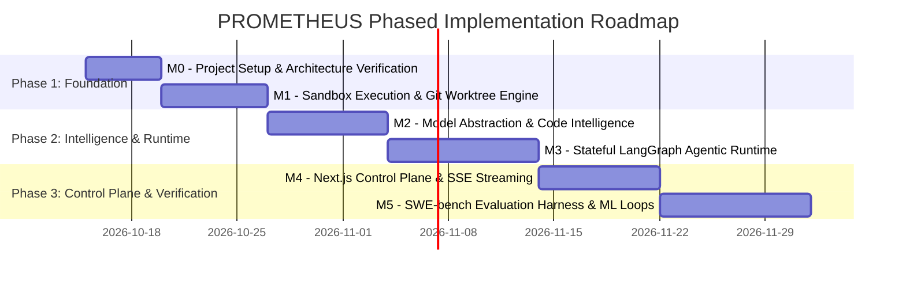

# PROMETHEUS — Concrete Implementation Plan

**Document Version:** 1.0.0  
**Status:** Approved Implementation Roadmap  
**Author:** Lead AI Systems Architect & Research Engineer  

---

## 1. Roadmap Overview & Phasing Principles

The implementation of PROMETHEUS is structured as a sequential series of independently verifiable milestones. Each milestone delivers concrete, testable code with strict exit criteria. No milestone depends on unbuilt future components; each builds upon verified foundations.



---

## 2. Milestone 0: Core Foundation, Tooling & Environment Verification

### 2.1 Scope & Objectives
Establish the repository structure, dependency management, linting/formatting standards, PostgreSQL migration harness, OpenTelemetry base tracing, and configuration management.

### 2.2 Concrete Deliverables
1. **Repository Layout:** Monorepo scaffolding with `/backend` (Python 3.12), `/frontend` (Next.js 14+), `/sandbox` (Docker definitions), and `/docs`.
2. **Environment & Configuration:** `pydantic-settings` schema (`backend/core/config.py`) loading typed environment variables with sensible defaults and strict validation.
3. **Database Schema & Migrations:** Alembic setup with initial migrations:
   - `projects` table (Git repos, base branches).
   - `issues` table (Bug reports, stack traces, expected behaviors).
   - `runs` table (Execution runs, configurations, statuses).
   - `audit_logs` table (Security audit entries).
4. **OpenTelemetry Setup:** Tracer provider setup (`backend/core/telemetry.py`) with stdout / OTLP exporter and FastAPI middleware.
5. **Quality Tooling:** Root `pyproject.toml` configuring `ruff` and `mypy` (strict mode); GitHub Actions CI configuration.

### 2.3 Verification & Exit Criteria
- `ruff check .` and `ruff format --check .` pass with zero violations.
- `mypy backend` passes with zero errors under strict mode.
- Database migration script executes cleanly against a test PostgreSQL 16 container:
  ```bash
  alembic upgrade head
  ```
- Healthcheck endpoint `GET /api/v1/health` returns `{ "status": "healthy", "database": "connected" }`.

---

## 3. Milestone 1: Isolated Code Execution & Git Worktree Engine

### 3.1 Scope & Objectives
Build the security-isolated execution engine using the Docker Engine API and the concurrent Git worktree repository management service.

### 3.2 Concrete Deliverables
1. **Docker Sandbox Manager (`backend/sandbox/manager.py`):**
   - Container lifecycle manager: create, start, stream logs, kill, remove.
   - Hardened container profiles: `--cap-drop=ALL`, `no-new-privileges`, `pids-limit=256`, `memory=4g`, `read-only` rootfs, `tmpfs /tmp`.
   - Network toggle: ability to enforce `--network=none` for test execution.
   - Command execution runner capturing exit code, stdout, stderr, and wall-clock execution time with hard timeouts.
2. **Standard Docker Base Image (`sandbox/Dockerfile.sandbox`):**
   - Debian 12 minimal base with Python 3.10/3.11/3.12, Git, pytest, and standard build tools running as a non-privileged user (`uid=1000`).
3. **Git Worktree Engine (`backend/engine/git_manager.py`):**
   - Bare mirror clone manager (`git clone --mirror`).
   - Worktree creator (`git worktree add -b <branch> <path> <commit>`).
   - Patch application utility (`git apply --check` and `git apply`).
   - Worktree teardown and garbage collection.

### 3.3 Test Suite & Validation Commands
- **Unit Tests:** `backend/tests/test_git_manager.py` (verifies worktree creation, multi-worktree isolation, dirty worktree rejection, cleanup).
- **Integration Tests:** `backend/tests/test_sandbox.py` (spins up Docker sandbox, executes commands, tests timeout handling, tests fork-bomb defense, verifies network isolation).
- **Validation Command:**
  ```bash
  pytest backend/tests/test_git_manager.py backend/tests/test_sandbox.py -v
  ```

### 3.4 Exit Criteria
- Containerized execution cannot write outside `/workspace` and `/tmp`.
- A deliberate fork-bomb (`:(){ :|:& };:`) is halted cleanly by `pids-limit=256` without crashing the host.
- Outbound network requests fail when `--network=none` is active.
- Concurrent git worktrees can be created and deleted without lock contention.

---

## 4. Milestone 2: Model Abstraction & Code Intelligence Engine

### 4.1 Scope & Objectives
Implement a vendor-neutral LLM provider layer and high-performance repository code intelligence (AST parsing, symbol indexing, ripgrep search, optional vector indexing).

### 4.2 Concrete Deliverables
1. **Model Provider Abstraction (`backend/models/provider.py`):**
   - Abstract base protocol `BaseModelProvider` supporting `generate()`, `generate_structured()`, and `stream()`.
   - Anthropic Provider (`Claude 3.5 Sonnet` via native Messages API).
   - OpenAI Provider (`GPT-4o` via Chat Completions / Structured Outputs).
   - Local / Generic Provider (Ollama / vLLM / llama.cpp OpenAI-compatible endpoint).
   - Retry policy with exponential backoff and token accounting.
2. **Code Intelligence Engine (`backend/code_intel/`):**
   - **AST Parser (`ast_parser.py`):** Tree-sitter integration extracting functions, classes, docstrings, and imports for Python (extensible to TS/JS).
   - **Symbol Graph (`symbol_index.py`):** Relational or in-memory symbol table linking definitions and callers.
   - **Ripgrep Adapter (`grep_search.py`):** Subprocess wrapper for ripgrep targeting worktree paths with path-traversal guards.
   - **Vector Indexer (`embeddings.py`):** Optional chunking and pgvector HNSW indexing; falls back cleanly if no embedding model is configured.

### 4.3 Test Suite & Validation Commands
- **Unit Tests:** `backend/tests/test_model_providers.py` (mocked provider calls, structured schema validation, fallback routing).
- **Unit Tests:** `backend/tests/test_code_intel.py` (Tree-sitter extraction of sample Python repository, symbol lookup accuracy, ripgrep filtering).
- **Validation Command:**
  ```bash
  pytest backend/tests/test_model_providers.py backend/tests/test_code_intel.py -v
  ```

### 4.4 Exit Criteria
- Provider switches seamlessly between Anthropic, OpenAI, and local Ollama via environment variable configuration.
- Tree-sitter correctly extracts 100% of top-level and nested functions in sample Python repositories.
- Code search returns exact file paths and line ranges with zero path traversal leakage.

---

## 5. Milestone 3: Stateful Agent Runtime & Autonomous Debugger

### 5.1 Scope & Objectives
Implement the core autonomous debugging loop using LangGraph, incorporating fault localization, minimal reproduction test generation, patch drafting, sandbox validation, and PostgreSQL checkpoint persistence.

### 5.2 Concrete Deliverables
1. **LangGraph State Schema (`backend/agent/state.py`):**
   - Typed `AgentState` containing: `issue_description`, `worktree_path`, `hypotheses`, `candidate_files`, `reproduce_script`, `patch_diff`, `sandbox_logs`, `iteration_count`, `resolved`.
2. **Agent Nodes & Tool Definitions (`backend/agent/nodes/`):**
   - `localize_fault`: Uses Code Intelligence tools to pinpoint faulty modules.
   - `generate_reproduce_test`: Formulates a minimal reproduction test script.
   - `execute_reproduction`: Executes test in sandbox, validating that it fails before the patch.
   - `synthesize_patch`: Generates unified diff based on localized root cause.
   - `verify_patch`: Applies patch to worktree and executes full test suite in sandbox.
   - `reflect_and_iterate`: Evaluates test failures and decides next hypothesis or termination.
3. **State Checkpointing (`backend/agent/checkpointer.py`):**
   - `PostgresSaver` binding preserving each state transition in PostgreSQL.
4. **Resumption Worker (`backend/agent/worker.py`):**
   - Recovers interrupted workflows upon service restarts.

### 5.3 Test Suite & Validation Commands
- **Unit Tests:** `backend/tests/test_agent_state.py` (state transitions, checkpoint serialization).
- **Integration Tests:** `backend/tests/test_debugging_pipeline.py` (end-to-end synthetic bug fixing on a mock Python repo: e.g. fixing an off-by-one error and verifying the patch in the sandbox).
- **Validation Command:**
  ```bash
  pytest backend/tests/test_debugging_pipeline.py -v
  ```

### 5.4 Exit Criteria
- Autonomous loop successfully fixes synthetic bugs in an isolated test repo without human intervention.
- The pipeline correctly rejects invalid patches when the sandbox test suite fails.
- Killing the worker process mid-execution and restarting it allows the task to resume from the last saved PostgreSQL checkpoint.

---

## 6. Milestone 4: Web Application & Interactive Control Plane

### 6.1 Scope & Objectives
Build the user-facing web dashboard in Next.js and TypeScript, delivering real-time agent trace streaming, interactive diff reviews, and human-in-the-loop intervention.

### 6.2 Concrete Deliverables
1. **Next.js Application Architecture (`frontend/`):**
   - Next.js 14+ App Router, TypeScript 5.5+, Vanilla CSS / Modern CSS Modules.
   - Custom design system: dark mode theme, glassmorphic panels, monospace code panels.
2. **Dashboard & Run Views:**
   - **Run Overview (`/runs`):** Table of active and historical debugging runs, filtering by repository, status, and duration.
   - **Active Run Control Room (`/runs/[id]`):**
     - Live agent thought log and terminal output via Server-Sent Events (`EventSource`).
     - Interactive unified diff viewer highlighting additions/deletions.
     - Human-in-the-loop controls: Approve patch, pause execution, re-run tests, or submit feedback to the agent.
3. **API Integration (`frontend/lib/api.ts`):**
   - Typed client wrappers for all FastAPI endpoints.

### 6.3 Test Suite & Validation Commands
- **Frontend Unit Tests:** `frontend/tests/DiffViewer.test.tsx`, `frontend/tests/RunStatus.test.tsx` using `vitest` and `@testing-library/react`.
- **E2E / Build Validation:**
  ```bash
  cd frontend && npm run lint && npm run test && npm run build
  ```

### 6.4 Exit Criteria
- `npm run build` generates optimized production assets with zero TypeScript or linting errors.
- Real-time SSE messages render in the browser UI without layout shift or dropped frames.
- Diff viewer correctly parses and colors multi-file unified diffs.

---

## 7. Milestone 5: Evaluation Harness, Benchmarking & Continuous Improvement

### 7.1 Scope & Objectives
Integrate the SWE-bench evaluation benchmark harness, establish baseline measurements, build experiment tracking, and validate ML fine-tuning pipelines.

### 7.2 Concrete Deliverables
1. **SWE-bench Integration Adapter (`backend/eval/swebench_runner.py`):**
   - Ingestion pipeline for SWE-bench Lite and SWE-bench Verified task instances.
   - Evaluation executor running the official test oracle in isolated containers.
   - Patch validation and export (`eval/results/predictions.json`).
2. **Baseline Benchmarking Harness (`backend/eval/baselines/`):**
   - Baseline 1: Zero-shot direct LLM prompt patch generator (no tools, no sandbox).
   - Baseline 2: Simple ReAct loop with file editing tools.
   - Baseline 3: Full PROMETHEUS LangGraph pipeline.
3. **Experiment & Hypothesis Tracker (`backend/eval/experiments.py`):**
   - Automated comparison of Pass@1, localization accuracy, token cost, and execution duration across runs.
4. **Grounded ML Training Pipeline (`backend/ml/`):**
   - Extraction of successful debugging trajectories from PostgreSQL.
   - Training script for cross-encoder retrieval ranker using PyTorch & HuggingFace.

### 7.3 Test Suite & Validation Commands
- **Benchmark Smoke Test:** Run PROMETHEUS against 3 curated SWE-bench Lite task instances:
  ```bash
  python -m backend.eval.swebench_runner --dataset lite --subset 3 --output eval_report.json
  ```

### 7.4 Exit Criteria
- Verifiable, reproducible benchmark report generated in JSON and Markdown formats.
- Complete audit trail of token counts, dollar costs, and execution times recorded for every evaluated instance.
- Clear empirical comparison confirming PROMETHEUS outperforms direct zero-shot prompting.
