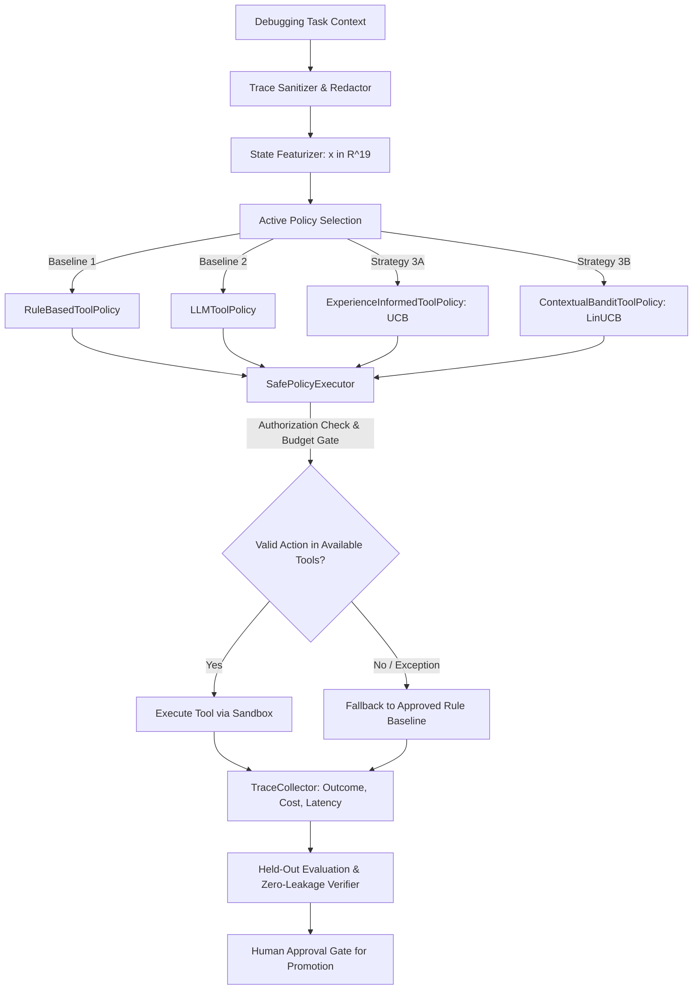

# PROMETHEUS Experimental Strategy Learning Subsystem

The **PROMETHEUS Experimental Strategy Learning Subsystem** (`prometheus_ai.learning.strategy`) is a disciplined meta-decision framework designed to empirically optimize tool-selection and investigation strategies using recorded execution outcomes.

---

## 1. Important Architectural Distinction

> [!IMPORTANT]
> **No Claims of Self-Modification or Autonomous Emergence**:
> The subsystem **does not modify the underlying language model's weights, fine-tuning state, or core prompt parameters**. It does not claim that the model modifies its own intelligence or automatically becomes a better language model.
>
> The objective is strictly empirical: **improving tool-selection and investigation sequencing using recorded execution traces**, framed as a contextual decision problem under strict resource and safety constraints.

---

## 2. Formal Learning Specification

### 2.1 State Representation ($\mathbf{x} \in \mathbb{R}^{19}$)
Each state context $s_t$ is transformed by `StateFeaturizer` into a normalized numerical feature vector $\mathbf{x} \in [0.0, 1.0]^{19}$:

| Feature Index | Feature Name | Description | Normalization |
|---|---|---|---|
| $0 \dots 8$ | `category_one_hot` | One-hot representation of `TaskCategory` (9 categories) | $\{0.0, 1.0\}$ |
| $9$ | `step_progress` | Workflow phase index | $\min(\text{step} / 10.0, 1.0)$ |
| $10$ | `candidate_files` | Count of identified target candidate files | $\min(\text{files} / 5.0, 1.0)$ |
| $11$ | `issue_len` | Character length of issue description | $\min(\text{chars} / 500.0, 1.0)$ |
| $12$ | `history_depth` | Prior tool call count in workflow | $\min(\text{history} / 10.0, 1.0)$ |
| $13$ | `prior_failures` | Prior tool failure frequency in workflow | $\min(\text{fails} / 5.0, 1.0)$ |
| $14$ | `has_error_context`| Presence of stack trace or test failure diagnostics | $1.0$ if present, else $0.0$ |
| $15$ | `is_syntax_error` | Diagnostic indicator for syntax or indentation error | $1.0$ if present, else $0.0$ |
| $16$ | `is_test_failure` | Diagnostic indicator for assertion/exit code failure | $1.0$ if present, else $0.0$ |
| $17$ | `is_missing_file`  | Diagnostic indicator for missing imports or files | $1.0$ if present, else $0.0$ |
| $18$ | `intercept`        | Bias/intercept term | Constant $1.0$ |

### 2.2 Action Space ($A_t$)
- Discrete action space strictly constrained to authorized tools:
  $$A_t = \text{context.available\_tools} \subseteq \mathcal{T}$$
- **Safety Invariant**: A policy is strictly forbidden from proposing or invoking actions outside $A_t$. Any violation is immediately intercepted by `SafePolicyExecutor` and reverted to the approved default baseline.

### 2.3 Multi-Objective Reward Formulation ($R$)
Execution outcomes are scored through a transparent, multi-objective reward function incorporating step success, overall task resolution, financial expenditure, and execution latency:

$$R = w_{\text{outcome}} \cdot \mathbb{I}(\text{outcome} = \text{SUCCESS}) + w_{\text{resolved}} \cdot \mathbb{I}(\text{task\_resolved}) - w_{\text{failure}} \cdot \mathbb{I}(\text{outcome} = \text{FAILURE}) - w_{\text{cost}} \cdot \text{cost\_usd} - w_{\text{latency}} \cdot \min\left(\frac{\text{latency\_ms}}{1000}, 1.0\right) - w_{\text{invalid}} \cdot \mathbb{I}(a \notin A_t)$$

- **Default Parameters**:
  - $w_{\text{outcome}} = 1.0$
  - $w_{\text{resolved}} = 2.0$
  - $w_{\text{failure}} = 0.5$
  - $w_{\text{cost}} = 5.0$ (penalizes excessive model or execution costs)
  - $w_{\text{latency}} = 0.1$ (penalizes long investigation delays)
  - $w_{\text{invalid}} = 5.0$ (heavily penalizes invalid tool selection)

### 2.4 Minimum Data Requirements
- To avoid premature exploitation on sparse noisy data, experimental policies require a minimum trace threshold ($\text{min\_traces} \ge 5$) before relying on learned priors.
- Below this threshold, policies transparently fall back to rule-based heuristics.

---

## 3. Implemented Baselines & Strategies

### Baseline 1: Fixed Rule-Based Strategy (`RuleBasedToolPolicy`)
- Deterministic, category-driven phase ordering.
- Sequence: `inspect_git_status` / `list_permitted_files` $\to$ `search_source_code` $\to$ `read_bounded_file` $\to$ `run_allowlisted_tests` / `apply_patch`.
- Acts as the primary approved production default and guaranteed fallback.

### Baseline 2: LLM-Selected Strategy (`LLMToolPolicy`)
- Prompts an LLM provider with task metadata and the strict list of `available_tools`.
- Extracts structured tool decisions.
- Intercepts invalid or hallucinated tool recommendations and reverts to approved fallback.

### Strategy 3A: Experience-Informed Strategy (`ExperienceInformedToolPolicy`)
- Empirically aggregates win rates, cost distributions, and task resolution frequencies from recorded traces.
- Employs Upper Confidence Bound (UCB) heuristic across tool priors:
  $$\text{score}(a) = \hat{\mu}_a + c \cdot \sqrt{\frac{\ln(N + 1)}{n_a + 1}}$$

### Strategy 3B: Contextual Bandit (`ContextualBanditToolPolicy`)
- Disjoint Linear Upper Confidence Bound (LinUCB) contextual bandit.
- For each authorized tool $a$, maintains ridge regression state $(\mathbf{A}_a \in \mathbb{R}^{d \times d}, \mathbf{b}_a \in \mathbb{R}^d)$ where $\mathbf{A}_a = \mathbf{D}_a^T \mathbf{D}_a + \lambda \mathbf{I}_d$.
- Computes ridge estimator $\hat{\boldsymbol{\theta}}_a = \mathbf{A}_a^{-1} \mathbf{b}_a$ and UCB score:
  $$\text{score}_a = \mathbf{x}^T \hat{\boldsymbol{\theta}}_a + \alpha \sqrt{\mathbf{x}^T \mathbf{A}_a^{-1} \mathbf{x}}$$
- Selects $\arg\max_{a \in A_t} \text{score}_a$ and updates parameters online or in batch from observed traces.

---

## 4. Safety & Governance Architecture

1. **Approved Fallback Always Online**: The system maintains `approved_default` (initially `RuleBasedToolPolicy`) permanently active. If an experimental policy throws an exception, times out, selects an unauthorized tool, or lacks data, the execution automatically falls back without disruption.
2. **Strict Authorization & Sandbox Compliance**:
   - `SafePolicyExecutor` checks `decision.selected_tool in context.available_tools`.
   - Never allows arbitrary command execution, path traversal, or unallowlisted binaries.
3. **Budget Enforcer (`BudgetEnforcer`)**:
   - Enforces ceilings on:
     - `max_tool_calls_per_task` (e.g., 20 calls)
     - `max_cost_usd_per_task` (e.g., $1.00)
     - `max_latency_seconds_per_task` (e.g., 180s)
   - Halts execution with `BudgetExceededError` if any threshold is violated.
4. **Human Approval Gate for Policy Promotion**:
   - Experimental policies **cannot promote themselves to production default**.
   - `PolicyRegistry.promote_to_default(...)` strictly requires:
     - Non-empty human approver ID (`approved_by`).
     - Cryptographic/verifiable authorization token (`approval_token`).
     - Held-out evaluation report demonstrating zero regressions.
     - Documented justification written to durable audit logs.

---

## 5. Evaluation & Zero-Leakage Protocol

- **Dataset Partitions**: Evaluated on disjoint Training, Tuning, and Held-Out task splits.
- **Leakage Prevention (`DataLeakageError`)**:
  - Validates $\text{IDs}(\text{Train} \cup \text{Tuning}) \cap \text{IDs}(\text{HeldOut}) = \emptyset$.
  - Cryptographically verifies content SHA-256 hashes:
    $$\text{Hashes}(\text{Train} \cup \text{Tuning}) \cap \text{Hashes}(\text{HeldOut}) = \emptyset$$
- **Metrics Tracked**:
  - **Task Success Rate** ($\%$)
  - **Regression Rate** ($\%$) on tasks previously resolved by baseline
  - **Tool-Call Efficiency** (mean tool calls per resolved task, uninformative tool ratio)
  - **Monetary Cost** (total and mean USD)
  - **Execution Latency** (total and mean seconds)
- **Repeated Trials**: Supports multi-trial execution per task to eliminate non-deterministic variance.
- **Outcome Classification**:
  - `IMPROVED`: Statistically significant resolution gain ($\Delta \ge +5\%$) or efficiency improvement ($\ge 0.2$ tool calls saved) with zero or negligible regressions ($< 10\%$).
  - `DEGRADED`: Performance drops ($\Delta \le -5\%$) or excessive regressions ($\ge 20\%$).
  - `INCONCLUSIVE`: Outcome differences lie within empirical noise margins ($|\Delta| < 5\%$).
