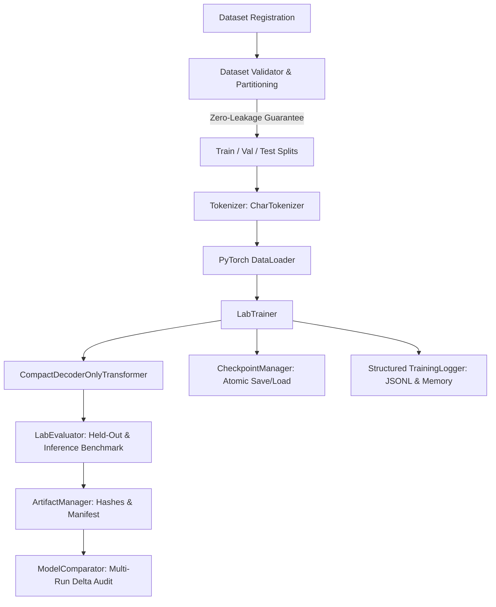

# PROMETHEUS Machine Learning Laboratory

The **PROMETHEUS Machine Learning Laboratory** (`prometheus_ai.learning.lab`) is a dedicated subsystem for training, evaluating, checkpointing, and benchmarking small transformer models.

In accordance with architectural principles, the laboratory's training pipeline is **strictly separated from the autonomous debugging runtime** (`prometheus_ai.agents`, `prometheus_ai.execution`, `prometheus_ai.memory`).

---

## Architecture Overview



### Subsystem Boundaries

| Subsystem | Scope & Role | Isolation Barrier |
|---|---|---|
| **Autonomous Debugging Runtime** | Agent workflows, tool executions, sandbox containers, memory retrieval | Never runs training loops or downloads unvetted weights. Uses frozen inference models. |
| **ML Laboratory Subsystem** | Model definitions, dataset preparation, local CPU/GPU training, checkpointing, benchmarking | Self-contained in `prometheus_ai/learning/lab/`. No side effects on agent execution or databases. |

---

## Core Features

1. **Dataset Registration (`DatasetRegistry`)**:
   Tracks dataset name, version, origin, license, intended use, creation timestamp, and SHA-256 content hashes.
2. **Dataset Validation (`DatasetValidator`)**:
   Enforces structural integrity, non-emptiness, UTF-8 validity, context length limits, and rejects null bytes.
3. **Train, Validation, and Test Partitioning**:
   Partitions datasets using exact ratios. Performs strict cryptographic hash cross-checks to ensure **zero data leakage** between splits (`DataLeakageError`).
4. **Self-Contained Tokenization (`CharTokenizer`)**:
   Lightweight, zero-download tokenizer with special tokens (`<pad>`, `<unk>`, `<bos>`, `<eos>`). Supports serialization and round-trip fidelity.
5. **Compact Decoder-Only Transformer (`CompactDecoderOnlyTransformer`)**:
   Configurable vocabulary, context length, layer depth, attention heads, embedding dimension, feed-forward dimension, and weight tying. Defaults to sub-100k parameters for fast CPU training.
6. **Atomic Checkpoint Saving & Recovery (`CheckpointManager`)**:
   Atomically writes `.pt` checkpoint weights, optimizer states, scheduler state, and metadata to temporary files before replacement. Supports loading and resuming exact training steps.
7. **Held-Out Evaluation (`LabEvaluator`)**:
   Evaluates next-token cross-entropy loss, perplexity ($e^{\text{loss}}$), token prediction accuracy, and generates completions from sample prompts.
8. **Reproducible Experiment Configuration (`ExperimentConfig`)**:
   Hierarchical Pydantic/dataclass configurations with deterministic random seeds across PyTorch and Python runtimes.
9. **Structured Training Logs (`TrainingLogger`)**:
   Emits real-time step and validation metrics to in-memory history and structured `training_logs.jsonl` files (tracking throughput, loss, elapsed time, and peak memory in MB).
10. **Model Artifact Management (`ArtifactManager`)**:
    Packages model summaries, configs, tokenizers, evaluation reports, benchmarks, and checkpoints into an isolated directory accompanied by a cryptographic `manifest.json` verifying file SHA-256 checksums.
11. **Inference Benchmarking**:
    Measures latency distribution (mean, p50, p90, p99) and token throughput (tokens/sec) over warmup passes and repeated iterations.
12. **Comparative Model Configuration Analysis (`ModelComparator`)**:
    Computes parameter and metric deltas across runs. Validates dataset and vocabulary compatibility before comparing metrics.

---

## Data Quality & Licensing

- **Dataset Provenance**: The default educational corpus (`create_synthetic_debug_corpus`) consists of synthetic Python errors and repairs created specifically for PROMETHEUS under the **Apache-2.0** license.
- **Intended Use**: Educational experimentation, architectural exploration, and testing.
- **Leakage Prevention**: Every split registration verifies that $\text{train} \cap (\text{val} \cup \text{test}) = \emptyset$.
- **Versioning**: Datasets are addressed and persisted by `name@version`.

---

## Evaluation Integrity & Metric Comparability

> [!WARNING]
> **Incompatible Evaluation Boundary**:
> Cross-entropy loss and perplexity are strictly dependent on the underlying vocabulary size and sample distribution.
> Comparing perplexity between models with different tokenizers or trained on different datasets is mathematically invalid.
> The `ModelComparator` enforces strict compatibility audits and raises `IncompatibleEvaluationError` if direct equivalence is attempted across disparate conditions.

### Small-Scale Experiment Limitations

1. **No Emergence**: Compact models (e.g. <1M parameters) do not exhibit emergent reasoning, planning, or generalized understanding. They operate strictly as small statistical pattern interpolators.
2. **Domain Specificity**: High token accuracy on synthetic debug strings demonstrates training convergence, not general programming competence.
3. **Evaluation Claims**: No model trained within this laboratory shall be claimed to be "intelligent" or "competitive" without rigorous, standardized, held-out benchmarks.

---

## Resource Controls & Cancellation

- **Step & Epoch Bounds**: Configurable `max_steps` and `max_epochs`.
- **Wall-Clock Limits**: Configurable `max_train_time_seconds` enforces automatic timeout.
- **Cooperative Cancellation**: `CancellationToken` checked before every batch allows safe external interruption and preserves emergency checkpoints.

---

## Running the Demo

To execute the baseline training run and one-factor variation comparison:

```bash
python scripts/demo_ml_lab.py
```

To run all laboratory unit tests:

```bash
pytest tests/unit/test_ml_lab.py -v
```
